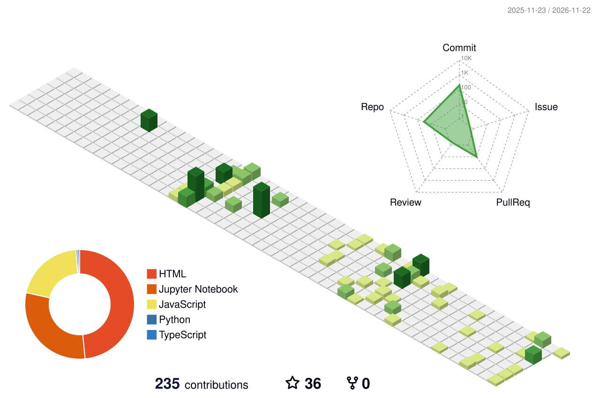

<!-- ====================================================== -->
<!--          KALAKANHU SWAIN | GITHUB PROFILE              -->
<!--              BLACK + NEON GREEN THEME                  -->
<!-- ====================================================== -->

<div align="center">


<br/>


<br/><br/>


</div>

---

## 🖥️ WHOAMI

```bash
┌──(kalakanhu㉿github)-[~]
└─$ whoami

Kalakanhu Swain
AI/ML Engineer | Data Analyst | Developer

┌──(kalakanhu㉿github)-[~]
└─$ cat about.txt

Passionate about Artificial Intelligence,
Machine Learning and Data Science.

Building intelligent applications,
exploring datasets and developing
solutions to real-world problems.

┌──(kalakanhu㉿github)-[~]
└─$ echo $MISSION

LEARN → BUILD → INNOVATE → DEPLOY
```

---

## 👨‍💻 ABOUT ME

🚀 Passionate about Artificial Intelligence, Machine Learning and Data Science.

- 🔭 Working on AI/ML and Data Analytics projects.
- 🌱 Learning Advanced Machine Learning and MLOps.
- 🧠 Interested in Computer Vision and AI-powered applications.
- 💻 Building full-stack applications using React, Flask and FastAPI.
- 📊 Experienced in Exploratory Data Analysis and predictive modelling.
- 🤝 Open to collaborating on AI/ML and Data Science projects.
- 🎯 Goal: Become a professional AI/ML Engineer.

---

---

## 👾 PAC-MAN CONTRIBUTION GAME

<div align="center">

</div>
---

<h2 align="center">🚀 FEATURED PROJECTS</h2>

<table width="100%" cellspacing="12" cellpadding="12">
<tr>

<td width="50%" align="center" valign="top">

<a href="https://github.com/kalakanhuswain18-hub/Credit-Card-Fraud-Detection">

</a>

<h3>💳 Credit Card Fraud Detection</h3>
<p>Machine Learning based fraud detection and imbalanced dataset analysis.</p>


<br/><br/>
<a href="https://github.com/kalakanhuswain18-hub/Credit-Card-Fraud-Detection">

</a>

</td>

<td width="50%" align="center" valign="top">

<a href="https://github.com/kalakanhuswain18-hub/networksecurity">

</a>

<h3>🛡️ Network Security – Phishing Detection</h3>
<p>Machine Learning based phishing website detection using 31 website features and 11,055 records.</p>


<br/><br/>
<a href="https://github.com/kalakanhuswain18-hub/networksecurity">

</a>

</td>
</tr>

<tr>

<td width="50%" align="center" valign="top">

<a href="https://github.com/kalakanhuswain18-hub/SmartReco">

</a>

<h3>🤖 SmartReco</h3>
<p>Smart product recommendation application with a modern web interface.</p>


<br/><br/>
<a href="https://github.com/kalakanhuswain18-hub/SmartReco">

</a>

</td>

<td width="50%" align="center" valign="top">

<a href="https://github.com/kalakanhuswain18-hub/Flask-Data-Analytics-Dashboard">

</a>

<h3>📊 Data Analytics Dashboard</h3>
<p>Interactive dashboard for data exploration and visualization.</p>


<br/><br/>
<a href="https://github.com/kalakanhuswain18-hub/Flask-Data-Analytics-Dashboard">

</a>

</td>
</tr>
</table>

<div align="center">
<br/>
<a href="https://github.com/kalakanhuswain18-hub?tab=repositories">

</a>
</div>

---

---

## 🚀 GALAGA CONTRIBUTION GAME

<div align="center">

</div>

---


## 🪐 TECH STACK UNIVERSE

### 💻 Programming Languages

<p align="center">
  
</p>

### 🧠 AI / Machine Learning / Data Science

<p align="center">
  
  
  
  
  
</p>

### 🌐 Web Development

<p align="center">
  
</p>

### ⚙️ Database, DevOps & Tools

<p align="center">
  
</p>

---


---


### 🔥 More Projects

| Project | Description | Technologies |
|---|---|---|
| 🛡️ CrowdShield | Crowd detection, tracking and heatmap analytics | YOLOv8, OpenCV, FastAPI |
| 🤖 JobMatch AI | Resume parsing and job matching | Python, PyMuPDF, TF-IDF |
| ❤️ Heart Disease Prediction | Machine learning-based prediction | SVM, Scikit-learn, Flask |
| 🎓 Student Performance Predictor | Predictive analytics application | Python, ML, Flask |
| 🌲 FWI Prediction | Forest fire weather index prediction | Python, ML |
| 📊 Titanic EDA | Exploratory data analysis | Python, Pandas, Matplotlib |

<div align="center">

<a href="https://github.com/kalakanhuswain18-hub?tab=repositories">
  
</a>

<a href="https://student-performance-predictor-wnbe.onrender.com">
  
</a>

</div>

---

## 📊 GITHUB ANALYTICS

<div align="center">


<br/>


</div>

---

## 🧊 3D CONTRIBUTION UNIVERSE

<div align="center">



</div>

---

## 🌐 CONNECT WITH ME

<div align="center">

<a href="https://www.linkedin.com/in/kalakanhu-swain-5a2360361/">
  
</a>

<a href="mailto:kalakanhuswain18@gmail.com">
  
</a>

<a href="https://github.com/kalakanhuswain18-hub">
  
</a>

</div>

<p align="center">
  📧 Email: kalakanhuswain18@gmail.com
  <br/>
  💼 LinkedIn: <a href="https://www.linkedin.com/in/kalakanhu-swain-5a2360361/">Connect with me</a>
  <br/>
  💻 GitHub: <a href="https://github.com/kalakanhuswain18-hub">My repositories</a>
</p>

---

<div align="center">

### 💚 THINK. BUILD. DEPLOY. REPEAT.


**Thanks for visiting my profile!**

⭐ If you like my work, consider following me.

</div>
